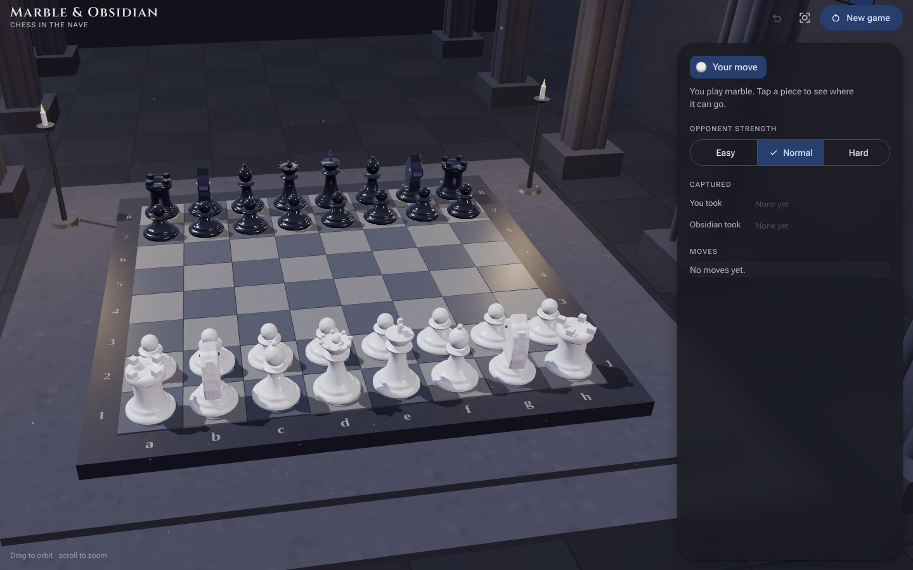
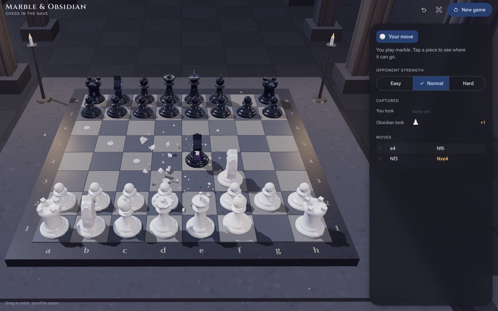
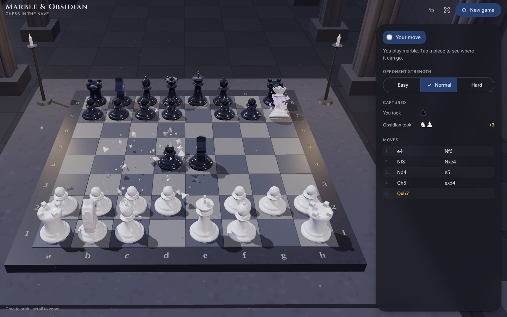
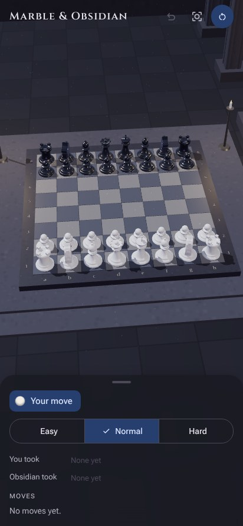

# Marble & Obsidian

Playable 3D chess in a minimalist Gothic cathedral. You play marble against an obsidian computer opponent.



## Screenshots

| Obsidian captures a pawn | Marble queen captures on h7 |
| --- | --- |
|  |  |



**On phones** the game panel becomes a bottom sheet under the board. Drag to orbit the camera and pinch to zoom.

The screenshots were taken in a headless browser with software rendering, so lighting and reflections on a real graphics card may look a little different.

<br clear="right">

## Features

- Full rules: check, checkmate, stalemate, castling, en passant, promotion, threefold repetition, fifty-move rule, insufficient material
- Three opponent strengths (search depth 1, 3 and 4)
- Idle, move, attack and shatter animations for every piece
- Single-screen Material 3 interface

The game is a static site: one `index.html` plus a bundled copy of three.js r128 in `site/vendor/`. It needs no build step and no backend. The computer opponent runs in a Web Worker in the browser.

Planned address: https://chess.rampai.my

## Run it

```bash
docker compose up -d --build
```

The container listens on `127.0.0.1:8087`. If that port is taken on your server, change the left-hand number in `docker-compose.yml`.

## Expose it through Cloudflare Tunnel

Add a public hostname to the tunnel:

- Hostname: `chess.rampai.my`
- Service: `http://localhost:8087`

If the tunnel uses a config file instead of the dashboard, add this ingress rule above the catch-all rule, then restart `cloudflared`:

```yaml
- hostname: chess.rampai.my
  service: http://localhost:8087
```

## Update it

```bash
git pull
docker compose up -d --build
```

## Files

| Path | What it is |
| --- | --- |
| `site/index.html` | The whole game: UI, 3D scene, chess engine |
| `site/vendor/three.min.js` | three.js r128 (MIT licence, see `three-LICENSE.txt`) |
| `docs/screenshots/` | Images used in this README |
| `nginx.conf` | Static file server with gzip and cache headers |
| `Dockerfile`, `docker-compose.yml` | Container setup |

## Notes

- Fonts load from Google Fonts. Without internet access on the client side, the page falls back to system fonts and the toolbar icons show as text.
- Desktop: drag to orbit, scroll to zoom. Phone: drag to orbit, pinch to zoom.
